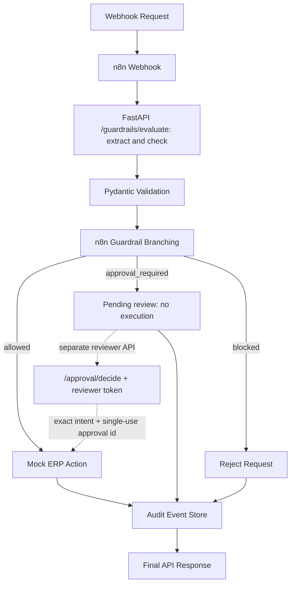

# ai-agent-execution-layer-demo

**Status: mock-first execution-control demo.** The default extractor uses deterministic rules; optional provider adapters are present but live extraction has not been verified in this maintenance run. ERP actions are simulations. The workflow stops high-risk requests at pending review and never automatically approves them. A separate token-authenticated API can record a decision bound to the exact intent; execution rechecks guardrails and consumes that approval once. This is not a production identity, policy or payment system.

`ai-agent-execution-layer-demo` is a practical demo showing why raw LLM agents should not directly execute actions inside ERP or production systems, and how an orchestration layer such as n8n can wrap AI reasoning inside deterministic controls, approvals, validation, and audit logging.

## Problem Statement

Teams are increasingly using LLMs to interpret emails, support tickets, supplier messages, and operational requests. That reasoning is useful. The risk appears when a model is allowed to directly trigger vendor payments, inventory changes, or other ERP writes without deterministic checks.

This demo shows a safer pattern:

- A mock-first extractor produces intent; optional model adapters require separate live verification.
- n8n handles orchestration and branching.
- Guardrails decide whether execution is allowed, blocked, or requires approval.
- Mock ERP endpoints simulate controlled system writes.
- Audit events record workflow outcomes, explicit reviewer decisions and successful mock executions. They are not tamper-proof or a complete request-access log.

## Why Raw AI Agents Are Risky Inside ERP Systems

- LLM output is probabilistic, while ERP writes must be deterministic.
- A plausible extraction can still be wrong, incomplete, or low-confidence.
- Production actions need thresholds, allow-lists, approval paths, and traceability.
- Human reviewers need clear evidence for high-risk requests before execution.

## Architecture Overview

The repo demonstrates an execution-layer pattern rather than a real ERP connector.



## Demo Scenario

An incoming webhook contains a request for either:

- a vendor payment, or
- an inventory update

The workflow sends text to `/guardrails/evaluate`, which extracts and checks intent once. Low-risk actions can proceed to the mock ERP. High-risk actions stop at pending review. The execution endpoints independently recheck the same intent and reject blocked actions or missing, mismatched, rejected or already-used approvals.

## Explicit review API

Set `APPROVAL_API_KEY` in your local `.env`. Keep that key with the reviewer, not the agent or n8n workflow. Approval is disabled with HTTP 503 if the key is not configured.

An operator reviews the exact `extracted_intent` returned by `/guardrails/evaluate`, then sends:

```text
POST /approval/decide
X-Reviewer-Token: <your local reviewer key>

{"request_id":"<same id>","decision":"approve","approver":"<reviewer label>","comments":"<review reason>","intent":{<exact extracted_intent>}}
```

This returns `approval_id`. Execute the same intent through `/erp/vendor-payment` or `/erp/inventory-update` with `X-Approval-Id: <approval_id>`. Changing any intent field or reusing the approval is refused. A rejection cannot authorize execution. The `approver` label is caller supplied; the shared token does not establish an individual human identity. `/approval/simulate` remains an explicitly labeled illustration and never creates a usable approval.

The supplied intent and vendor state are still demo inputs, not authoritative ERP records. A real adapter needs trusted server-side lookups, action authorization, authenticated reviewer identities, idempotency and recovery controls.

## Setup Instructions

1. Create and activate a Python 3.11+ virtual environment.
2. Copy `.env.example` to `.env`.
3. Install dependencies:

```bash
pip install -r requirements.txt
```

4. Start the API:

```bash
uvicorn app.main:app --reload --host 0.0.0.0 --port 8000
```

## Docker Compose Instructions

Build and run the demo stack:

```bash
docker compose up --build
```

Services:

- FastAPI demo API: `http://localhost:8000`
- n8n: `http://localhost:5678`

## How To Import The n8n Workflow

1. Start n8n.
2. Open the n8n UI.
3. Choose import workflow.
4. Import [workflows/n8n-ai-execution-layer-demo.json](workflows/n8n-ai-execution-layer-demo.json).
5. Update any base URL values if your API is not running at `http://host.docker.internal:8000` or `http://api:8000`.

## Sample curl Commands

Health check:

```bash
curl http://localhost:8000/health
```

Low-risk inventory extraction:

```bash
curl -X POST http://localhost:8000/agent/extract \
  -H "Content-Type: application/json" \
  -d @sample_payloads/low_risk_inventory_update.json
```

Guardrail evaluation:

```bash
curl -X POST http://localhost:8000/guardrails/evaluate \
  -H "Content-Type: application/json" \
  -d @sample_payloads/high_risk_vendor_payment.json
```

List audit events:

```bash
curl http://localhost:8000/audit/events
```

## Screenshots

See [docs/screenshots-placeholder.md](docs/screenshots-placeholder.md) for suggested captures.

## Security Notes

This is a demo only. Before using a similar pattern against a real ERP, add:

- authentication and authorization
- RBAC
- secure approval design
- rate limits
- secret management
- stronger audit retention and tamper controls
- environment isolation

Self-hosting helps control infrastructure, but it does not automatically guarantee compliance. GDPR or local compliance depends on implementation details, hosting, contracts, subprocessors, and data handling controls.

More detail: [docs/security-notes.md](docs/security-notes.md)

## What This Demo Proves

- AI extraction can be useful without granting direct system write authority.
- A visual orchestration layer can enforce deterministic guardrails around AI output.
- High-risk actions can be routed into approvals instead of direct execution.
- Audit logging makes decisions reviewable and explainable.

## What This Demo Is Not

- not a production ERP integration
- not a replacement for security architecture
- not a compliance guarantee
- not a real-time payment engine

## Need This Adapted To Your ERP Stack?

This architecture can be adapted for Odoo, Oracle, Django/FastAPI backends, n8n orchestration, approval workflows, audit logs, and AI extraction or validation layers. If you need a version tailored to your operational model, the safest approach is to design the guardrails and approval paths around your real business rules before any live ERP write is introduced.

## Repo Layout

- [app/main.py](app/main.py)
- [app/agent_service.py](app/agent_service.py)
- [app/guardrails.py](app/guardrails.py)
- [app/mock_erp.py](app/mock_erp.py)
- [workflows/n8n-ai-execution-layer-demo.json](workflows/n8n-ai-execution-layer-demo.json)
- [docs/architecture.md](docs/architecture.md)
- [docs/demo-script.md](docs/demo-script.md)

