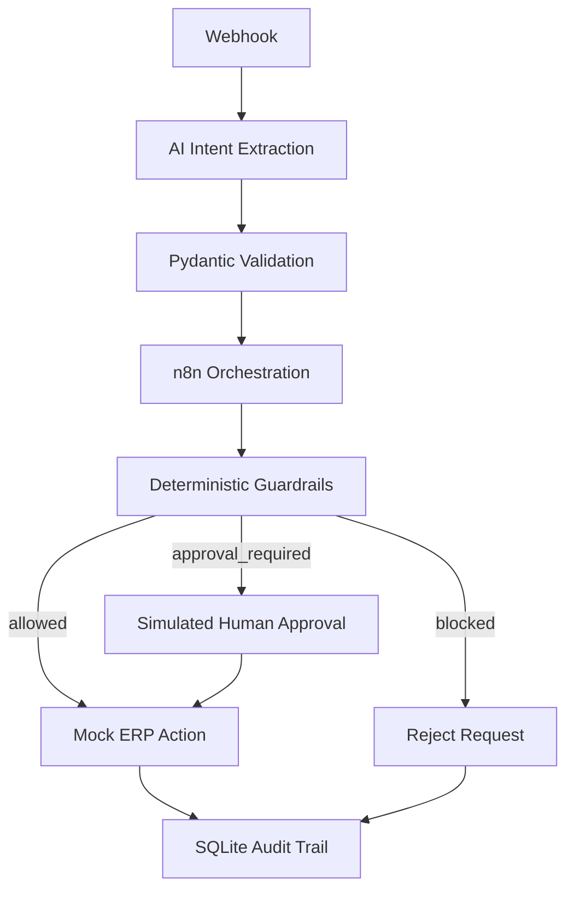

# AI Agent Execution Layer Demo

[](https://www.python.org/)
[](https://fastapi.tiangolo.com/)
[](https://n8n.io/)
[](https://docs.docker.com/compose/)

A reference architecture showing how natural-language requests can become controlled, auditable mock ERP actions. An LLM may extract intent, but Pydantic validation, deterministic guardrails, n8n branching, and human approval determine whether execution is allowed.

> **AI can reason. Deterministic systems should control execution.**

## Why This Exists

LLMs are probabilistic; business-system writes require deterministic controls. A plausible model response can still be incomplete, wrong, or low-confidence. This demo puts an explicit execution boundary between AI reasoning and authorization to act.

## Architecture



The LLM produces structured intent; it does **not** authorize a business action. See the [architecture notes](docs/architecture.md) for component boundaries.

## What the Demo Demonstrates

- Mock-first or optional OpenAI/Groq structured intent extraction
- Pydantic schema and type validation
- Confidence scoring
- Deterministic payment and inventory thresholds
- `allowed`, `approval_required`, and `blocked` decisions
- A simulated approval step for portfolio demonstration
- Mock ERP execution with generated references
- SQLite audit events containing the request, decision, approval state, and result

## Example Scenarios

| Scenario | Expected result | Reason |
| --- | --- | --- |
| Inventory adjustment of 40 units | `allowed` | Identifier present, confidence sufficient, below threshold |
| Vendor payment of USD 18,500 | `approval_required` | Above the USD 10,000 default threshold |
| Inventory adjustment over 500 units | `approval_required` | Above the default inventory threshold |
| Otherwise-valid low-confidence request | `approval_required` | Confidence below 0.75 |
| Payment to an inactive vendor | `blocked` | Deterministic vendor-status rule |
| Missing vendor/item identifier | `blocked` | Required identifier absent |
| Unknown action or malformed request | validation error / `blocked` | Schema or allow-list rejects it |

## Tech Stack

- Python 3.11
- FastAPI and Uvicorn
- Pydantic and pydantic-settings
- n8n
- SQLite
- pytest and HTTPX
- Docker and Docker Compose

## Quick Start

Requirements: Python 3.11+ and a shell. Mock mode is the default and requires no paid API key.

```bash
python -m venv .venv
# macOS/Linux
source .venv/bin/activate
# Windows PowerShell
# .\.venv\Scripts\Activate.ps1

python -m pip install -r requirements.txt
cp .env.example .env
python -m uvicorn app.main:app --host 0.0.0.0 --port 8000
```

On Windows, copy the environment file with `Copy-Item .env.example .env`.

Verify the API:

```bash
curl http://localhost:8000/health
```

Interactive API documentation is available at `http://localhost:8000/docs`.

## Docker Setup

```bash
docker compose config
docker compose up --build
```

- API: `http://localhost:8000`
- n8n: `http://localhost:5678`

The Compose network exposes the API to n8n as `http://api:8000`. The included workflow uses that address.

## Import the n8n Workflow

1. Start the Compose stack.
2. Open n8n at `http://localhost:5678`.
3. Import [the workflow JSON](workflows/n8n-ai-execution-layer-demo.json).
4. Review the nodes before activating the workflow.

If n8n runs outside this Compose project, replace `http://api:8000` in the imported workflow with an address that reaches the API from that n8n runtime.

The included approval node automatically returns `approved` for demonstration. It is not an authenticated human-approval control.

## Example Requests

```bash
# Extract a low-risk inventory intent
curl -X POST http://localhost:8000/agent/extract \
  -H "Content-Type: application/json" \
  -d @sample_payloads/low_risk_inventory_update.json

# Evaluate the deterministic guardrails
curl -X POST http://localhost:8000/guardrails/evaluate \
  -H "Content-Type: application/json" \
  -d @sample_payloads/high_risk_vendor_payment.json

# Inspect audit records created by the workflow or audit endpoint
curl http://localhost:8000/audit/events
```

Additional examples are in [sample_payloads](sample_payloads/), and the full walkthrough is in the [demo script](docs/demo-script.md).

## Configuration

Copy `.env.example` to `.env` and adjust only what you need:

| Variable | Safe default | Purpose |
| --- | --- | --- |
| `MOCK_MODE` | `true` | Uses deterministic local extraction |
| `DEFAULT_LLM_PROVIDER` | `mock` | `mock`, `openai`, or `groq` |
| `MIN_CONFIDENCE` | `0.75` | Minimum confidence for automatic execution |
| `PAYMENT_APPROVAL_THRESHOLD` | `10000` | Payments above this require approval |
| `INVENTORY_APPROVAL_THRESHOLD` | `500` | Absolute unit changes above this require approval |
| `DATABASE_URL` | `sqlite:///./audit.db` | SQLite audit database |
| `OPENAI_MODEL` / `GROQ_MODEL` | See `.env.example` | Optional provider model |
| `OPENAI_API_KEY` / `GROQ_API_KEY` | empty | Optional provider credential; never commit real values |

When mock mode is disabled, a missing provider key produces an explicit error instead of silently executing with mock extraction. Provider timeouts, HTTP failures, invalid JSON, and schema failures are also returned as extraction failures.

## Guardrail Outcomes

- **ALLOWED:** supported action, required identifier, sufficient confidence, and threshold checks pass.
- **APPROVAL_REQUIRED:** payment or inventory delta exceeds its threshold, or confidence is below the automatic threshold.
- **BLOCKED:** inactive vendor or missing action-specific identifier. Unsupported action values are rejected by the schema.

Guardrail decisions authorize only calls within this demo flow. The mock ERP endpoints themselves are intentionally simple simulators and are not secured production adapters.

## Audit Trail

Audit records contain the original request, extracted intent, validation/decision data, approval status, final mock ERP response, and timestamp. SQLite makes the demo easy to inspect; a production design would need access control, retention policy, integrity protections, and operational monitoring.

## Project Structure

```text
.
├── app/                    # API, extraction, schemas, guardrails, mock ERP, audit
├── docs/                   # Architecture, security notes, screenshots, demo script
├── sample_payloads/        # Example webhook requests
├── scripts/                # API launcher and audit seed utility
├── tests/                  # Validation, policy, API-flow, and mock ERP tests
├── workflows/              # Importable n8n workflow
├── .env.example
├── docker-compose.yml
├── Dockerfile
└── requirements.txt
```

Useful entry points: [FastAPI app](app/main.py), [intent extraction](app/agent_service.py), [guardrails](app/guardrails.py), and [mock ERP](app/mock_erp.py).

## Security and Production Considerations

A real implementation would additionally require authenticated service-to-service calls, authorization and RBAC, genuine approver authentication, secrets management, TLS, network/environment isolation, rate limits, idempotency, transaction controls, replay protection, database hardening, tamper-resistant logs, monitoring, alerting, incident response, and data-governance controls. Read [security notes](docs/security-notes.md).

## Demo Limitations

This repository is:

- not a production ERP connector or payment engine
- not a compliance or security guarantee
- not a complete authorization or approval system
- not connected to real vendor, banking, inventory, Odoo, or Oracle data
- intentionally using mock ERP actions and a simulated approval
- intended for learning, architecture discussion, portfolio demonstration, and prototyping

## Adaptation

The execution-boundary pattern could be adapted behind Odoo, Oracle, custom ERP adapters, or FastAPI/Django services. Those integrations are not included here; each would require its own business policies, identity model, transaction design, and operational controls.

## Screenshots

No screenshots are currently committed. The [screenshot guide](docs/screenshots-placeholder.md) lists truthful captures to take from a running demo.

## License

This project includes an [MIT License](LICENSE).
