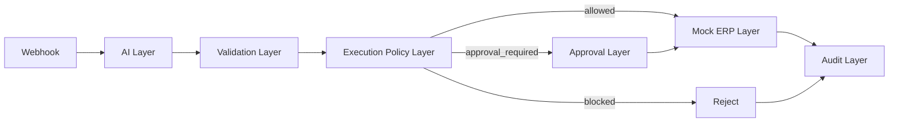

# Architecture

## Design Principle

**AI can reason. Deterministic systems should control execution.**

The system treats model output as untrusted proposed intent. LLM output does not equal authorization to execute a business action.

## Responsibility Boundaries

### AI Layer

`app/agent_service.py` interprets natural language and proposes structured intent. Mock extraction is enabled by default; OpenAI and Groq are optional. This layer has no execution authority.

### Validation Layer

`app/schemas.py` uses Pydantic to validate expected fields, types, enums, and confidence bounds. Malformed or unsupported action values are rejected before policy evaluation. n8n passes the validated extraction to `/guardrails/evaluate-intent`, avoiding a second model call.

### Execution Policy Layer

`app/guardrails.py` applies deterministic rules: supported action, required identifier, confidence, inactive-vendor blocking, and configurable payment/inventory thresholds. It returns `allowed`, `approval_required`, or `blocked`.

### Approval Layer

n8n routes sensitive requests through `/approval/simulate`. The included node automatically approves for demonstration and is not identity-backed human approval. Production use would need authenticated approvers, authorization, separation of duties, and durable decision records.

### Mock ERP Layer

`app/mock_erp.py` creates simulated payment or inventory results and generated references. It does not connect to an ERP or payment network.

### Audit Layer

`app/audit.py` and `app/database.py` store the request, intent, decision, approval status, simulated result, and timestamp in SQLite.

## Orchestration

The [n8n workflow](../workflows/n8n-ai-execution-layer-demo.json) visibly connects intake, extraction, guardrail evaluation, branching, simulated approval, mock execution, and audit write-back. Within Docker Compose it calls the API at `http://api:8000`.

## Trust Boundary

Only the deterministic decision path should authorize a call to a business adapter. A production adapter would also enforce authorization independently; workflow branching alone is not a security boundary.
